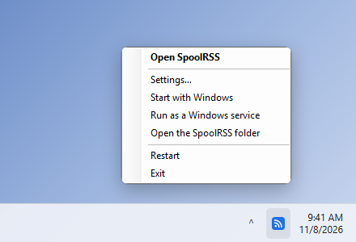
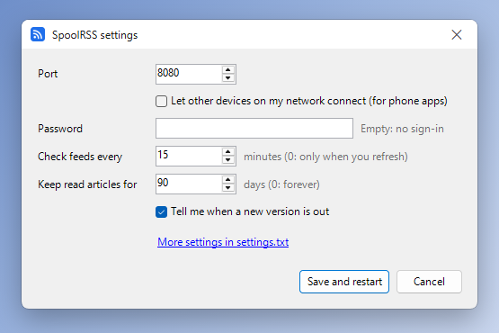

# SpoolRSS

A feed reader you run yourself, for RSS, Atom and JSON Feed. It works in any browser, syncs with reader apps on your phone, and has a browser extension that shows your unread count and finds the feeds on any page.


## Install

### Windows

Download **SpoolRSS-windows.zip** from the [latest release](https://github.com/tet0r/spoolrss/releases/latest), unzip it into your user folder (Documents, for example), and run **SpoolRSS.exe**. Nothing is installed.

SpoolRSS runs in the tray by the clock: click its icon to open it in your browser. Right-click the icon for its settings (port, network access, password), to start it with Windows or run it as a Windows service, or to restart or exit it. New versions install from within the app with **Update now**.

 


If SmartScreen warns about SpoolRSS.exe, choose **More info**, then **Run anyway**: it isn't code-signed.

### Docker

```yaml
services:
  spoolrss:
    image: ghcr.io/tet0r/spoolrss:latest
    restart: unless-stopped
    ports:
      - "8080:8080"
    environment:
      SPOOLRSS_PASSWORD: change-me
    volumes:
      - spoolrss-data:/data

volumes:
  spoolrss-data:
```

Save it as `docker-compose.yml` and run `docker compose up -d` (or paste it into Portainer as a stack), then open http://localhost:8080. To update: `docker compose pull && docker compose up -d`.

Without Docker, with Node.js 22.13 or later: `git clone https://github.com/tet0r/spoolrss.git && cd spoolrss && npm install && npm start`.

Coming from another reader? Import your subscriptions as OPML in **Settings**.

## Phone apps

In SpoolRSS, open **Settings → Reading apps** and choose a username and app password. Then add a **FreshRSS** account in your app with the address `https://your-server/api/greader.php` (or a **Fever** account with `/api/fever.php`). Apps that work: [Capy Reader](https://github.com/jocmp/capyreader), [Read You](https://github.com/Ashinch/ReadYou) and [FeedMe](https://github.com/seazon/FeedMe) on Android; [NetNewsWire](https://netnewswire.com/) and [Fiery Feeds](https://apps.apple.com/app/id1158763303) on iPhone and Mac.

Phone apps need SpoolRSS to be reachable over HTTPS, behind a reverse proxy such as Caddy or nginx.

## Browser extension

Get it for [Chrome and Edge](https://chromewebstore.google.com/detail/lecfbammajmdcafoodjalelofaelbaoc) or [Firefox](https://addons.mozilla.org/firefox/addon/spoolrss/). It shows your unread count and newest headlines, and subscribes to the feeds on the page you're viewing. It also works with FreshRSS, Miniflux, Tiny Tiny RSS, Nextcloud News and other readers with a Google Reader or Fever API.


## Settings

Environment variables for Docker, or lines in `settings.txt` for the Windows app:

| Setting | Default | What it does |
| --- | --- | --- |
| `SPOOLRSS_PASSWORD` | none | Requires sign-in. Set it if others can reach SpoolRSS. |
| `SPOOLRSS_REFRESH_MINUTES` | `15` | How often feeds are checked |
| `SPOOLRSS_RETENTION_DAYS` | `90` | Read articles older than this are deleted, unless starred or still in their feed. `0` keeps everything. |
| `PORT` | `8080` | The port to listen on |
| `HOST` | all addresses | `127.0.0.1` keeps SpoolRSS to this computer (the Windows app's default) |
| `UPDATE_CHECK` | `true` | Checks GitHub for new versions |

## Updating from Feedster

SpoolRSS was called Feedster. Change your image to `ghcr.io/tet0r/spoolrss:latest` and **keep your existing volume line**; everything carries over, and `FEEDSTER_` settings keep working.

## Development

`npm test` runs the tests. A new number in `VERSION`, pushed to `main`, publishes a release: the Docker image, the Windows app ([windows/](windows)) and the browser extension ([store/SUBMITTING.md](store/SUBMITTING.md)). What changed is in the [changelog](CHANGELOG.md).

## License

MIT. Bug reports and ideas are welcome in [issues](https://github.com/tet0r/spoolrss/issues).
