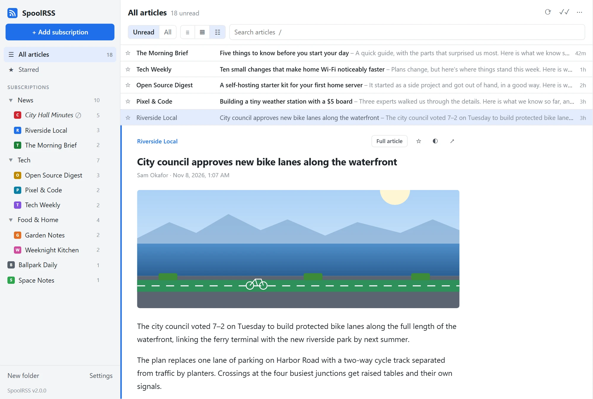
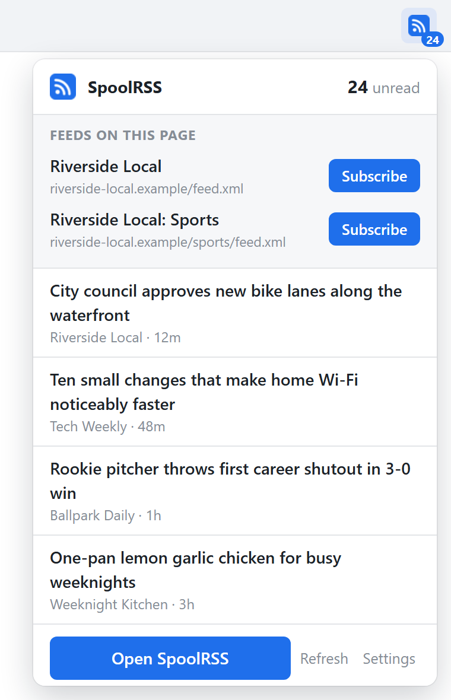

# SpoolRSS

A self-hosted feed reader for RSS, Atom and JSON Feed. Folders, unread counts, starring, search, full articles and keyboard shortcuts, in one small app you run yourself. Your subscriptions and reading history stay on your server.

Works in any browser, syncs with popular reader apps on Android and iPhone, and has a browser extension that shows your unread count and finds the feeds on any page you visit.

SpoolRSS used to be called Feedster. If you run Feedster, see [Updating from Feedster](#updating-from-feedster).



## Install

With Docker:

```yaml
services:
  spoolrss:
    image: ghcr.io/tet0r/spoolrss:latest
    restart: unless-stopped
    ports:
      - "8080:8080"
    environment:
      SPOOLRSS_PASSWORD: change-me
    volumes:
      - spoolrss-data:/data

volumes:
  spoolrss-data:
```

Save that as `docker-compose.yml` and run `docker compose up -d`, or paste it into Portainer as a stack. Then open http://localhost:8080 and add your first subscription. The fuller [docker-compose.yml](docker-compose.yml) in this repository adds a health check and more settings.

Without Docker, you need Node.js 22.13 or later:

```bash
git clone https://github.com/tet0r/spoolrss.git
cd spoolrss
npm install
npm start
```

Coming from another reader? Export your subscriptions as OPML and import the file in SpoolRSS's **Settings**.

## Features

- Subscribe with a feed address or just a website address. SpoolRSS finds the feed.
- Folders, drag and drop, unread and starred views, and search across every article
- Full articles for feeds that only send a summary
- A classic view in the style of the old Google Reader (one line per headline, and the article opens in place under it), a list with a reading pane, or cards
- Hide busy feeds from **All articles** and its unread count, and read them in their own view
- Feed icons, light and dark themes, and a layout that works on phones
- Resizable panes and keyboard shortcuts
- OPML import and export
- A banner when a new version of SpoolRSS is available

## Reader apps

SpoolRSS speaks the same sync APIs as FreshRSS, so apps that support FreshRSS work with it.

1. In SpoolRSS, open **Settings → Reading apps** and choose a username and app password.
2. In the app, add a **FreshRSS** account with the address `https://your-server/api/greader.php`.
3. Sign in with that username and app password.

Free apps that work this way:

| Platform | App |
| --- | --- |
| Android | [Capy Reader](https://github.com/jocmp/capyreader), [Read You](https://github.com/Ashinch/ReadYou), [FeedMe](https://github.com/seazon/FeedMe) |
| iPhone, iPad and Mac | [NetNewsWire](https://netnewswire.com/), [Fiery Feeds](https://apps.apple.com/app/id1158763303) |

Apps that only offer a **Fever** account can use `https://your-server/api/fever.php` instead. Phone apps need SpoolRSS to be reachable over HTTPS.

## Browser extension

The SpoolRSS extension for Chrome, Edge and Firefox shows your unread count on the toolbar. Click it to see your newest headlines, open your reader, or subscribe to the feeds on the page you're viewing in one click.



Install it from the [Chrome Web Store](https://chromewebstore.google.com/detail/lecfbammajmdcafoodjalelofaelbaoc) (Chrome and Edge) or [Firefox Add-ons](https://addons.mozilla.org/firefox/addon/spoolrss/).

It works with SpoolRSS and with other self-hosted readers:

| Reader | Sign in with |
| --- | --- |
| SpoolRSS | The username and app password from **Settings → Reading apps** |
| FreshRSS | Your username and API password |
| Miniflux | An API key |
| Tiny Tiny RSS | Your username and password, with the API turned on |
| Nextcloud News | Your Nextcloud username and an app password |
| Others with a Google Reader or Fever API | The API address, username and password |

Fever has no way to subscribe, so with a Fever account the extension offers to copy a feed's address instead.

Without the extension, drag the **+ SpoolRSS** bookmarklet from SpoolRSS's Settings to your bookmarks bar, and click it on any site to subscribe.

## Settings

Set these as environment variables:

| Variable | Default | What it does |
| --- | --- | --- |
| `SPOOLRSS_PASSWORD` | none | Requires sign-in. Set it if SpoolRSS can be reached from the internet. |
| `SPOOLRSS_REFRESH_MINUTES` | `15` | How often feeds are checked. `0` turns it off. |
| `SPOOLRSS_RETENTION_DAYS` | `90` | Read articles older than this are deleted, except starred ones and ones their feed still lists. `0` keeps everything. |
| `UPDATE_CHECK` | `true` | Checks GitHub for new versions. `false` turns it off. |
| `PORT` | `8080` | The port SpoolRSS listens on |
| `SPOOLRSS_DATA` | `./data` | Where the database is stored |

The `FEEDSTER_` names from before the rename still work.

SpoolRSS serves plain HTTP. For HTTPS, put it behind a reverse proxy such as Caddy, nginx or Traefik.

## Keyboard shortcuts

| Key | Action |
| --- | --- |
| `j` / `k` | Next / previous article |
| `n` / `p` | In the classic view: move to the next / previous headline without opening it |
| `o` or `Enter` | In the classic view: open or close the article |
| `s` | Star |
| `m` | Mark read or unread |
| `v` | Open the original page |
| `f` | Full article |
| `r` | Refresh |
| `Shift`+`A` | Mark all as read |
| `a` | Add a subscription |
| `/` | Search |

## Updating

Pull the latest image and restart: `docker compose pull && docker compose up -d`. To stay on one version, use a tag such as `ghcr.io/tet0r/spoolrss:2.0` instead of `latest`. What changed in each version is in the [changelog](CHANGELOG.md).

### Updating from Feedster

SpoolRSS is the new name for Feedster. Your subscriptions, articles, settings and sign-ins carry over.

1. In your compose file or Portainer stack, change the image to `ghcr.io/tet0r/spoolrss:latest`.
2. **Keep your existing volume line** (for example `feedster-data:/data`). Renaming it would start SpoolRSS with an empty database.
3. Pull and restart. On first start, SpoolRSS renames `feedster.db` to `spoolrss.db` in the same volume.

Your `FEEDSTER_PASSWORD` and other `FEEDSTER_` settings keep working; you can rename them to `SPOOLRSS_` whenever you like. The old image name `ghcr.io/tet0r/feedster` keeps receiving updates for now, so nothing breaks if you wait.

## Development

Run the tests with `npm test`. `node store/render/render-app.mjs` and `node store/render/render.mjs` remake the screenshots with made-up sample feeds. A new number in the `VERSION` file, pushed to `main`, publishes a release. Publishing the browser extension to the stores is described in [store/SUBMITTING.md](store/SUBMITTING.md).

## License

MIT. See [LICENSE](LICENSE). Bug reports and ideas are welcome in [issues](https://github.com/tet0r/spoolrss/issues).
